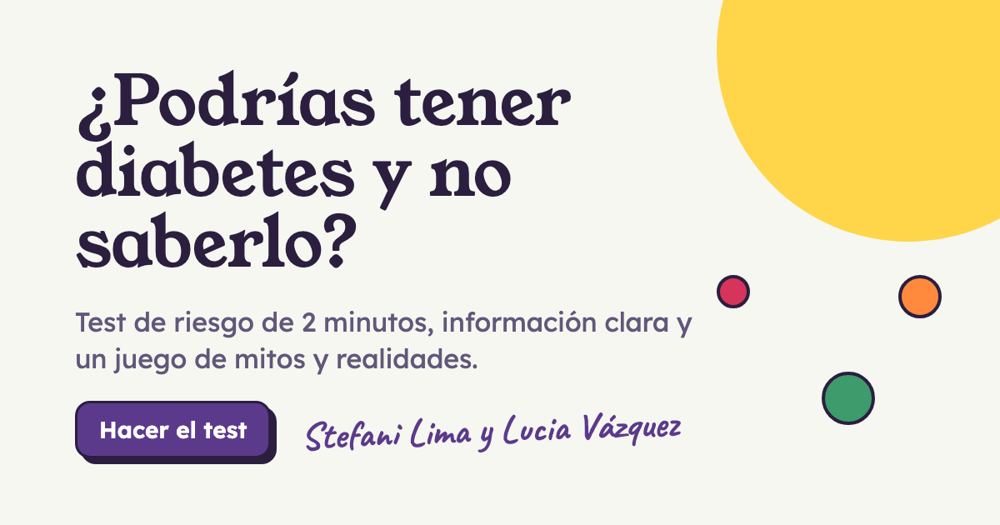
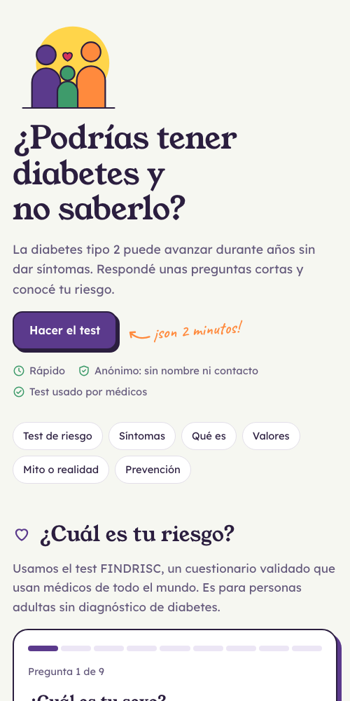

# ¿Podrías tener diabetes y no saberlo?

Página informativa sobre diabetes pensada para llegar a la gente a través de un código QR. En dos minutos cualquier persona puede calcular su riesgo de desarrollar diabetes tipo 2, aprender a reconocer los síntomas y poner a prueba lo que sabe con un juego de mitos y realidades.

Proyecto universitario de **Stefani Lima** y **Lucia Vázquez**. Desarrollo web de [Carlos Sánchez](https://cfsanchez.com).

**[c4snchz.github.io/diabetes](https://c4snchz.github.io/diabetes/)** · link corto: [is.gd/testdiabetes](https://is.gd/testdiabetes)

<p align="center"></p>

## Qué tiene la página

- **Test de riesgo FINDRISC.** Nueve preguntas sobre edad, peso, cintura, actividad física, alimentación y antecedentes. Al final muestra el puntaje, el nivel de riesgo, qué factores suman más y si conviene consultar con un médico.
- **Síntomas y tipos de diabetes**, explicados en lenguaje simple.
- **Semáforo de glucosa** con los valores de referencia de glucemia en ayunas, hemoglobina glicosilada (HbA1c) y prueba de tolerancia oral a la glucosa.
- **Juego "¿Mito o realidad?"** con nueve frases comunes sobre la diabetes y la explicación de cada una.
- **Prevención** y la **regla del 15** para actuar ante una baja de azúcar.
- **Estadísticas en vivo** con lo que respondió la gente: niveles de riesgo, factores más comunes y las frases del juego que más confunden.
- **Botones para compartir** por WhatsApp o copiando el link.

<p align="center"></p>

## Privacidad

Las respuestas se guardan de forma anónima para armar las estadísticas: solo la opción elegida en cada pregunta, el puntaje y el día. No se guarda el nombre, el contacto, la IP ni la hora. De la altura y el peso solo queda la categoría del índice de masa corporal (IMC).

El equipo tiene un panel con acceso por usuario y contraseña para ver todas las respuestas y descargarlas en PDF.

## Cómo está hecho

| Parte | Qué es |
|---|---|
| `index.html` | La página completa en un solo archivo: HTML, CSS y JavaScript sin dependencias. Se publica con GitHub Pages. |
| `admin.html` | Panel del equipo con el resumen, las tablas de respuestas y la descarga en PDF ([jsPDF](https://github.com/parallax/jsPDF)). |
| `stats-api/` | API en Cloudflare Workers con una base de datos D1. Guarda las respuestas anónimas y devuelve las estadísticas. |

### Publicar la API

```sh
cd stats-api
npx wrangler d1 execute diabetes-stats --remote --file=schema.sql   # solo la primera vez
npx wrangler secret put ADMIN_USER
npx wrangler secret put ADMIN_PASS
npx wrangler deploy
```

La página se actualiza sola al hacer push a `main`.

## Fuentes

- Lindström J, Tuomilehto J. *The Diabetes Risk Score: a practical tool to predict type 2 diabetes risk.* Diabetes Care, 2003. (Escala FINDRISC)
- American Diabetes Association. *Standards of Care in Diabetes.* (Valores de referencia)

## Aviso

Esta página es informativa y no reemplaza la consulta con un profesional de la salud. El test estima un riesgo y no hace un diagnóstico.
